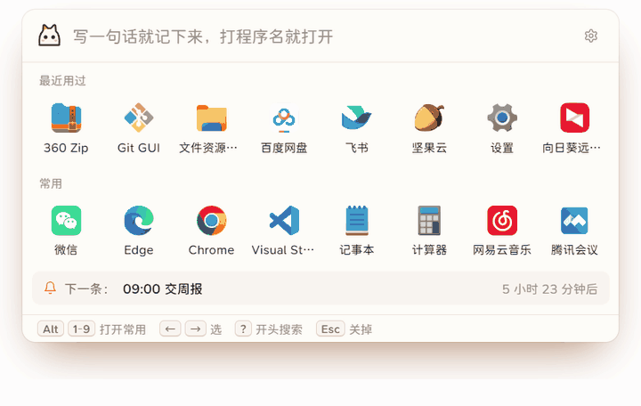
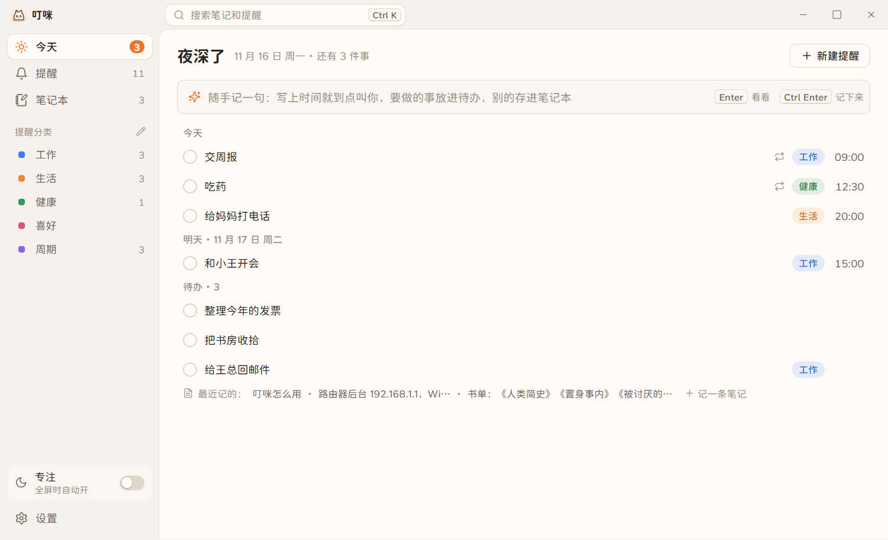
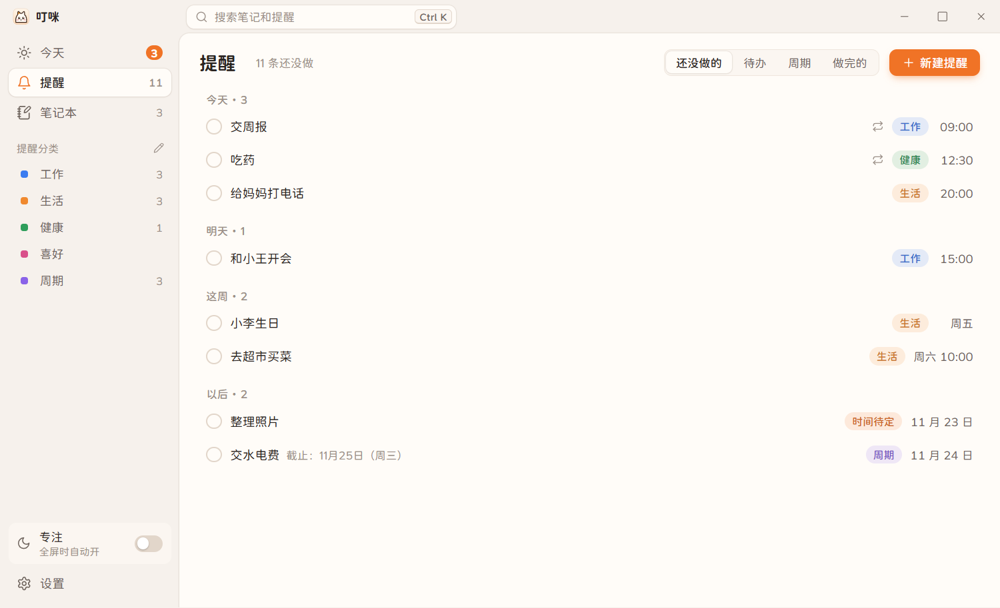
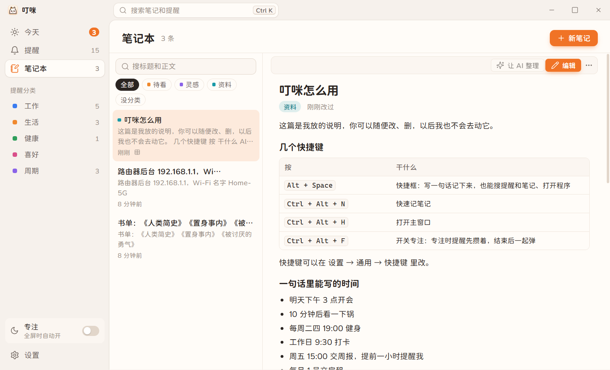

<p align="center">
  
</p>

<h1 align="center">Dingmi</h1>

<p align="center">
  <b>Free, open-source reminders, synced Markdown notes and an app launcher for Windows</b><br>
  Press one hotkey and type a sentence: anything with a time pops up when it's due, to-dos go to your to-do list, everything else goes into your notebook. Type an app's name to open it.
</p>

<p align="center">
  <a href="https://github.com/qingzo/dingmi/releases/latest"></a>
  
  <a href="LICENSE"></a>
  <a href="https://github.com/qingzo/dingmi/releases"></a>
</p>

<p align="center">
  <a href="https://github.com/qingzo/dingmi/releases/latest"><b>Download</b></a> ·
  <a href="https://dingmi.app">Website (Chinese)</a> ·
  <a href="README.md">中文</a>
</p>

> **Heads-up:** Dingmi's interface and its natural-language time parsing are **Chinese only** for now. It understands sentences like 「明天下午三点和小王开会」 ("meeting with Xiao Wang at 3 pm tomorrow"), not English ones yet.

<p align="center">
  
</p>

## Why Dingmi

- **One hotkey, three jobs**: reminders, notes and launching apps all live in one box (`Alt + Space`), instead of three separate tools.
- **Set reminders by just saying it**: "every month on the 15th, pay the credit card, remind me 2 days early", "every year on the 15th day of the 8th lunar month", "weekdays at 8:55". Parsed locally, works offline.
- **Free, open source, no account**: install and go. No sign-up, no ads.
- **Your data stays on your PC**: stored locally, exportable to Markdown at any time, backed up daily, with a recycle bin.
- **End-to-end encrypted sync**: across PCs and your phone via a cloud-drive folder, your own server, or the official paid service. Content is encrypted on your PC; servers only see ciphertext ([how it works, in Chinese](docs/加密和同步.md)).

## Features

- **Quick box** (`Alt + Space`): one sentence becomes a reminder, a to-do or a note. Understands times, weekdays, the lunar calendar, "remind me N days early", several events in one sentence. Select text first and it's brought in automatically.
- **Reminder cards** slide in from the bottom-right corner with a chime: done, 10 minutes later, tomorrow, snooze until… They stay until you deal with them.
- **Focus mode** turns on automatically when something is full-screen and holds non-urgent reminders until you're done.
- **To-dos**: things without a time get their own list, together with the unchecked `- [ ]` items from your notes. Add a time later and it becomes a reminder.
- **Notebook**: Markdown, images, files, tables; to-dos in notes can get reminders too. `Ctrl + Alt + N` opens a small window for quick notes.
- **Launcher**: pinyin and initials (`wx` finds 微信 WeChat), recent apps and pinned apps, search your notes with `?`, a calculator, web keywords.
- **Desktop widget**, **morning briefing** and **evening wrap-up**.
- **Phone**: with sync, view reminders and notes and send things to your PC from the phone's browser. No app to install.
- **Optional AI**: add your own DeepSeek API key for better time parsing and one-click note tidying. Everything works without it.

| Today | Reminders | Notebook |
| --- | --- | --- |
|  |  |  |

## Download

Get the installer from [Releases](https://github.com/qingzo/dingmi/releases/latest) (or [dingmi.app](https://dingmi.app)). Windows 10 / 11, 64-bit; installs for the current user, no admin rights needed. The self-hosted sync server for Linux (x86_64 and ARM64) is in Releases too.

The installer isn't code-signed yet, so Windows may show "Windows protected your PC": click "More info" → "Run anyway". Updates are signed separately and verified by the app.

## Open source and what isn't

- **Open source** (all in this repo): the Windows app, the phone web app, the sync server `dingmi-server` and the sync protocol. Build it and host your own server; nothing is missing.
- **Not open source**: the official paid sync service adds redeem codes, plans, connection logs and an admin panel on top of `dingmi-server` (hooked in via `apps/server/src/ext.rs`), plus the website.
- Encryption happens on your PC and your keys never leave your devices, so the official server only sees ciphertext. You can also self-host or use a cloud-drive folder for free.

## Building

Requires Node.js 20+, Rust (MSVC toolchain) and WebView2 (built into Windows 10/11). From the repo root:

```powershell
npm install
npm run tauri dev      # development
npm run tauri build    # installer in target/release/bundle/nsis/
npm run build:mobile   # rebuild apps/server/web/app.html after changing the phone web app
npm test               # front-end tests
cargo test --workspace # Rust tests (app, server, sync)
```

Set `DINGMI_DATA_DIR=<an empty folder>` before `npm run tauri dev` to keep the dev build away from your real data. Build the Linux server with `cargo zigbuild --profile server --target x86_64-unknown-linux-musl -p dingmi-server`; deployment guide (Chinese): [docs/自建服务器.md](docs/自建服务器.md).

Code comments mention internal requirement and design documents (「需求-1.0 第 x 节」, `docs/方案/`, `design/`); those aren't part of this repo. Comments and docs are in Chinese.

## How it was made

Dingmi is built by one person, 李青菜 (Li Qingcai), together with AI (Claude): the author decides the requirements, the interface and the trade-offs; most of the code and docs were written with AI; every release is used and tested by the author before it ships.

## Issues and feedback

Bug reports and ideas are welcome in [Issues](https://github.com/qingzo/dingmi/issues) (English is fine). Dingmi doesn't accept pull requests; see [CONTRIBUTING.md](CONTRIBUTING.md). Report security issues privately, see [SECURITY.md](SECURITY.md). If you find it useful, a star helps others find it.

## License and name

Copyright © 2026 李青菜.

- Code is licensed under [AGPL-3.0](LICENSE): free to use, modify and self-host; if you distribute a modified version (including as an online service), you must publish your changes.
- Third-party code, fonts and icons: [THIRD_PARTY_LICENSES.md](THIRD_PARTY_LICENSES.md).
- The name "叮咪 / Dingmi", the app icon and the mascot are not licensed with the code: if you ship a modified version, please use a different name and icon. Personal use and self-hosting are fine. See [TRADEMARK.md](TRADEMARK.md).
