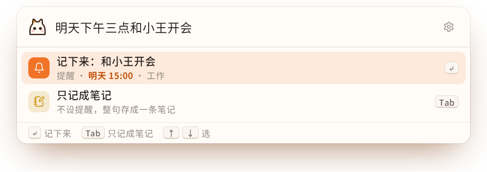
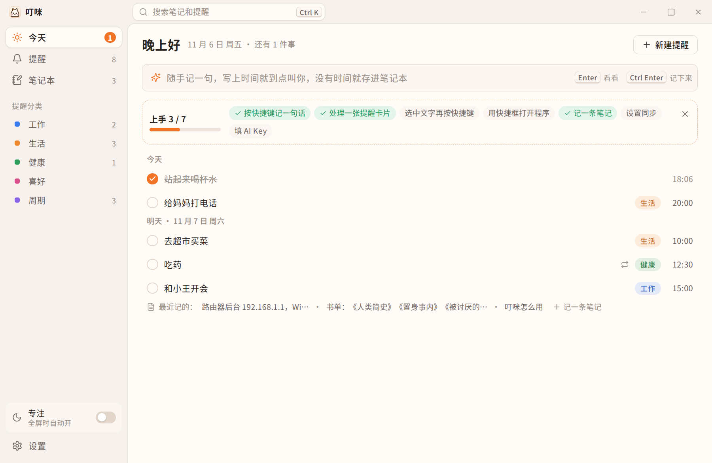
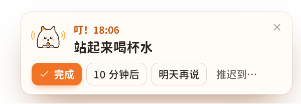
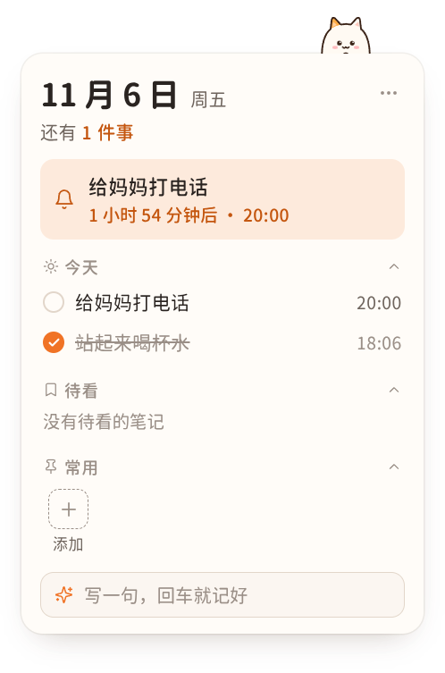

# 叮咪（Dingmi）

随手一记，到点叫你。叮咪是一个 Windows 上免费、开源的提醒和笔记工具：按一个快捷键写一句话，带时间的到点提醒你，没时间的存进笔记本；顺手还能打开程序、搜以前记的东西。



## 能做什么

- **快捷框**：在任何地方按 `Alt + Space`，写一句「明天下午三点和小王开会」，回车就记好了。几点、每周几、提前多久、几件事一起说都认得（见 [时间的说法](https://dingmi.app/docs/time/)）。先选中一段文字再按，文字会自动带进来。
- **打开程序、搜索、随手算**：打 `wx` 找到微信；`?周报` 找以前记的提醒和笔记；打算式直接出结果；`bd 天气` 用百度搜。
- **提醒卡片**：到点从右下角滑出来，「叮」一声。完成、10 分钟后、明天再说、推迟到…，不处理会一直留着。
- **专注**：全屏看视频、演示时自动开，不紧急的提醒先攒着。
- **每日开场白和每天收尾**：早上告诉你今天有几件事，傍晚看看做完了什么、没做完的挪到明天。
- **笔记本**：Markdown、图片、文件、表格，笔记里的待办也能设提醒；`Ctrl + Alt + N` 弹出小窗口快速记。
- **桌面组件**：桌面上一张卡片，今天的事、待看的笔记、常用程序。
- **同步**：几台电脑用同一份提醒和笔记，用网盘文件夹、自建服务器，或者官方的叮咪同步（收费）；内容先在电脑上加密，网盘和服务器上只有密文，见 [加密和同步是怎么做的](docs/加密和同步.md)。
- **手机**：用叮咪同步或者自建服务器的话，手机上能看提醒和笔记，也能把看到的东西发到电脑上（不用装 App）。
- **回收站、导出全部、每天自动备份、深色模式**。
- **让 AI 整理**（可选）：填上 DeepSeek 的 API Key，认时间更准，还能把随手贴的笔记整理成列表、表格。不填也能用。

| 主窗口 | 提醒卡片 | 桌面组件 |
| --- | --- | --- |
|  |  |  |

## 下载

到官网 [dingmi.app](https://dingmi.app) 或者 GitHub 的 [Releases](https://github.com/qingzo/dingmi/releases) 下载安装包，自建服务器的 Linux 程序也在 Releases 里。系统要求 Windows 10 / 11，64 位；只装给当前用户，不用管理员权限。

安装包还没有代码签名，Windows 可能弹出「Windows 已保护你的电脑」：点「更多信息」→「仍要运行」。详细见 [快速上手](https://dingmi.app/docs/quick-start/)。

## 使用说明

全部的使用说明在官网 [dingmi.app/docs](https://dingmi.app/docs/)：

- [快速上手](https://dingmi.app/docs/quick-start/)：下载安装、第一次打开、卸载
- [快捷框](https://dingmi.app/docs/quickbox/)、[时间的说法](https://dingmi.app/docs/time/)、[提醒](https://dingmi.app/docs/reminders/)、[笔记](https://dingmi.app/docs/notes/)、[桌面组件](https://dingmi.app/docs/widget/)
- [同步](https://dingmi.app/docs/sync/)：网盘文件夹、自建服务器；同步密码和恢复码
- [手机收件箱](https://dingmi.app/docs/mobile/)、[导出和恢复](https://dingmi.app/docs/export/)
- [隐私说明](https://dingmi.app/privacy/)：叮咪在电脑上存了什么、什么时候联网、服务器能看到什么；[用户协议](https://dingmi.app/terms/)

自己搭同步服务器（dingmi-server）的部署和命令行在仓库里：[自建同步服务器](docs/自建服务器.md)。同步的内容怎么加密、服务器能看到什么、防不住什么：[加密和同步是怎么做的](docs/加密和同步.md)。

## 自己编译

需要 Node.js 20+、Rust（MSVC 工具链）、WebView2（Windows 10/11 自带）。在仓库根目录：

```powershell
npm install
npm run tauri dev      # 开发模式
npm run tauri build    # 打包，安装包在 target/release/bundle/nsis/
npm run build:mobile   # 改了手机网页后，重新生成 apps/server/web/app.html
npm test               # 前端的测试
cargo test --workspace # Rust 的测试（电脑端、服务器、同步）
```

开发时不想碰正在用的叮咪：设置环境变量 `DINGMI_DATA_DIR=<一个空目录>` 再运行 `npm run tauri dev`，调试版会把数据放在那里，也可以和装好的叮咪同时开着。

同步服务器 dingmi-server 编译成 Linux 程序：`cargo zigbuild --profile server --target x86_64-unknown-linux-musl -p dingmi-server`（要装 zig 和 cargo-zigbuild），部署见 [自建同步服务器](docs/自建服务器.md)。

```
apps/
  desktop/          电脑端：ui/ 是界面（TypeScript + Vite），src-tauri/ 是 Rust 那一半
  mobile/           手机网页，打包进 apps/server/web/app.html
  server/           同步服务器 dingmi-server：自己搭、自己同步（叮咪同步的兑换码、到期这些不在开源版里，见 src/ext.rs）
crates/sync/        电脑端和服务器共用的同步协议
shared/             电脑端和手机网页共用的界面代码
docs/自建服务器.md  自建同步服务器：部署和命令行
docs/加密和同步.md  钥匙、盒子、服务器能看到什么
docs/截图/          README 和使用说明用的截图（scripts/docs-shots 截的）
scripts/            打包、发版签名、生成图标和许可证清单的脚本
```

代码注释里常见的「需求-1.0 第 x 节」「同步方案第 x 节」「UI设计 U6」「安全审查第 x 条」，以及 `docs/方案/`、`design/` 这些路径，指的是作者自己的需求、设计文档和设计稿，没有放进这个仓库。

## 哪些开源，哪些不开源

- **开源**（都在这个仓库里）：电脑端叮咪、手机网页、同步服务器 dingmi-server、同步协议。自己编、自己搭服务器，功能是全的。
- **不开源**：官方的叮咪同步在 dingmi-server 上加了兑换码、套餐和到期、连接记录、管理后台（接进来的地方见 `apps/server/src/ext.rs`），还有官网。这部分是收费服务的运营，不放出来。
- **为什么不影响你判断安全**：加密都在电脑上做，钥匙不离开你的设备；叮咪同步的服务器跑的就是这里的 dingmi-server 加上面那些，拿到的也只有密文。不放心的话，可以看代码，也可以自己搭服务器、用网盘文件夹，一分钱不花。手机网页是服务器发的，这一点要信任服务器，[加密和同步是怎么做的](docs/加密和同步.md) 最后一节说清楚了。

## 怎么做出来的

叮咪是李青菜（一个人）和 AI（Claude）一起做的：需求、界面、取舍由作者定，大部分代码和文档是和 AI 一起写的，每一版都由作者自己用、自己测过再发。

## 问题和建议

发现问题、有想法，欢迎在 GitHub 上开 Issue。叮咪只接受问题和建议，不接受代码合并请求，原因见 [CONTRIBUTING.md](CONTRIBUTING.md)。发现安全问题请私下告诉作者，见 [SECURITY.md](SECURITY.md)。

## 许可证和名字

版权所有 © 2026 李青菜（作者）。

- 代码用 [AGPL-3.0](LICENSE) 许可证：可以免费用、改、自己搭服务器；改了以后拿去给别人用（包括做成在线服务），要把改过的代码也公开。
- 用到的别人的代码、字体、图标见 [THIRD_PARTY_LICENSES.md](THIRD_PARTY_LICENSES.md)。
- 「叮咪」「Dingmi」这个名字、程序图标和团子猫形象不随代码开放：改了代码另发一版，请换名字和图标。只是自己用、或者自建服务器，不受影响。见 [TRADEMARK.md](TRADEMARK.md)。
